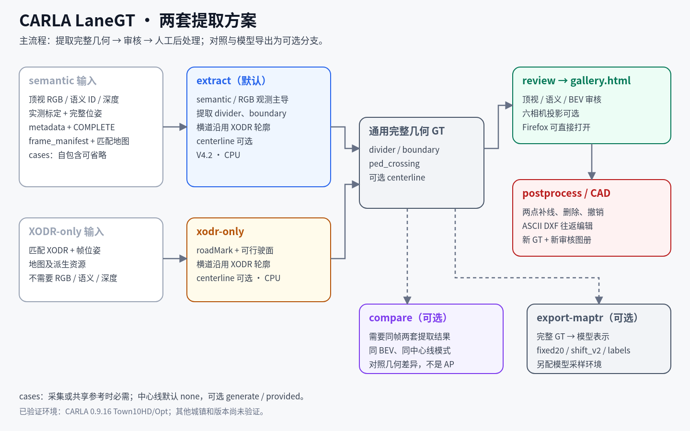
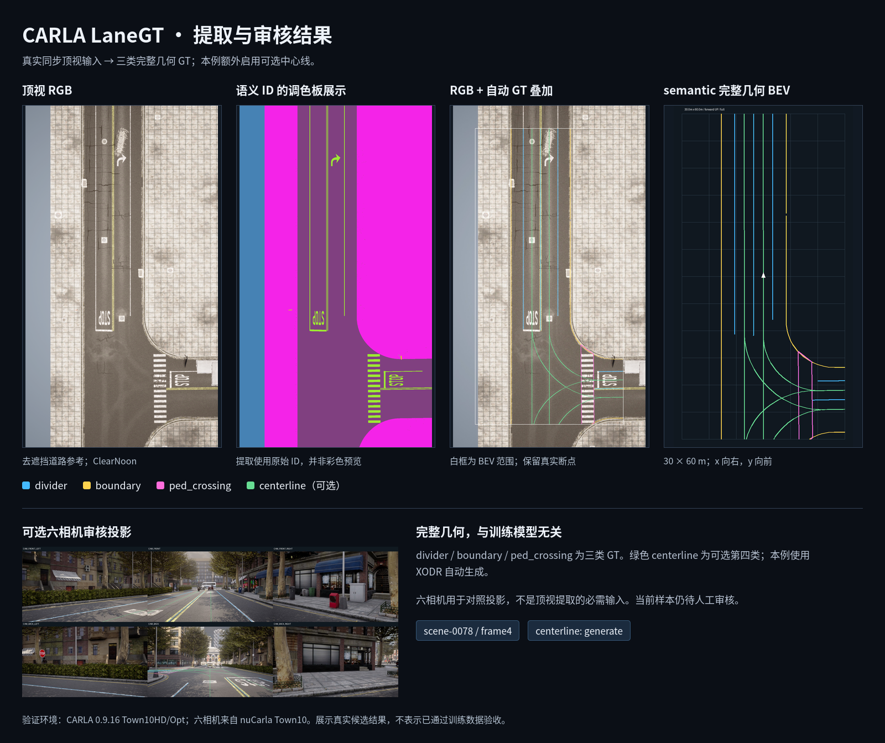
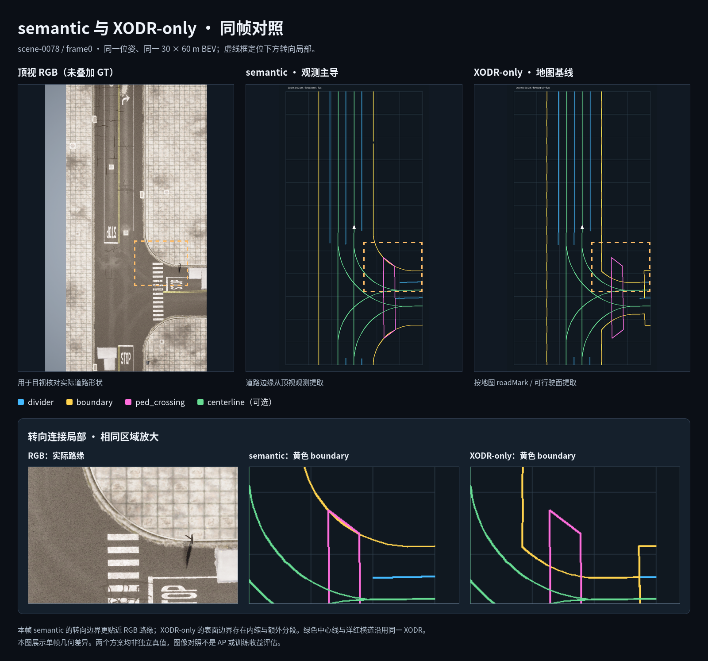
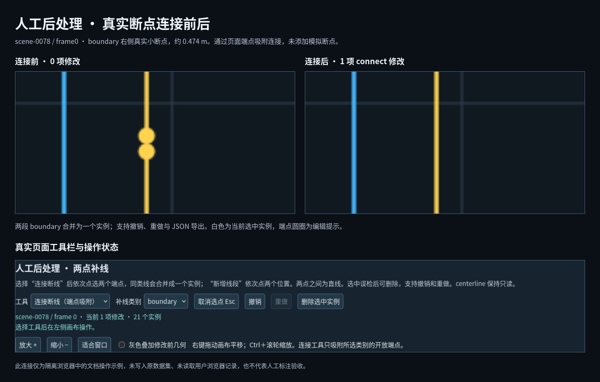

# CARLA LaneGT · Render-Grounded Road GT Toolkit

[中文说明](README.md) | English

CARLA LaneGT is a road-vector ground-truth generation and correction toolkit for CARLA scenes. It was motivated by GT discontinuities, geometric offsets, and mismatches with actual CARLA rendering encountered while preparing MapTRv2 fine-tuning data. Some of these issues trace back to differences between XODR geometry and the rendered scene. The toolkit combines matched-map top-down RGB, semantic ID maps, depth arrays, and XODR priors to extract and correct road annotations per GT class.



## GT classes

| Class | Meaning |
|---|---|
| `divider` | Lane divider. Double yellow lines are merged into a center curve; dashed gaps are logically connected. |
| `boundary` | Road / sidewalk boundary observed from the rendered scene. |
| `ped_crossing` | Pedestrian-crossing outline from the matched XODR. |
| `centerline` | Optional lane centerline, generated from XODR or imported from prepared labels. |

These classes are not tied to MapTRv2. The current release provides an optional MapTRv2 sampling adapter; the underlying complete geometry can be converted to other vector-map perception models.

## Two extraction schemes

| Entry | Scheme |
|---|---|
| `python run.py extract` | Default V4.2 B hybrid extraction. Divider uses the XODR V4.1 stitched base with semantic supplements; boundary, crosswalks, and centerlines keep their observation/XODR sources. |
| `python run.py xodr-only` | XODR-only map baseline built from roadMark, drivable-surface union, and object outlines; V4.1 adds rejected-line recovery plus topology, same-road local, and ≤0.5 m geometric stitching. It does not read RGB, semantic, or depth. |

Both schemes share full poses, BEV range, complete geometry, optional model sampling, and the review/editing interface. The optional `compare` command renders same-frame BEV comparisons.

## What you get

- Model-agnostic complete geometry (`lanegt_geometry_v1`) in metres, model-local x-right / y-forward / z-up.
- Optional MapTRv2 sampling: `fixed20 (N,20,2)`, `shift_v2 (N,19,20,2)`, class labels, and sampling diagnostics.
- HTML review gallery with top-down RGB, semantic preview, GT overlay, complete BEV, instance-level review, and optional six-camera projections.
- Page-level two-point patching, audit JSON/CSV export, and ASCII DXF round-trip editing with a matching `context.json`.
- GT extraction and optional sampling run on CPU. Re-capturing top-down references requires CARLA and a GPU.

## Validation scope

- Validated on **CARLA 0.9.16 Town10HD / Town10HD_Opt** with matching resource fingerprints.
- Other towns, CARLA versions, elevated roads, and multi-level scenes are not validated.
- Validation used local CARLA top-down captures and nuCarla Town10 six-camera samples.
- Raw images, map resources, model weights, GT files, and review outputs are **not** included. Selected documentation images are under `docs/images/`; see `THIRD_PARTY_NOTICES.md`.

## Inputs

A semantic extraction frame needs:

1. A frame manifest and an exact full pose. `cases` is optional for self-contained metadata, but required for shared references or re-capture.
2. Top-down `rgb.png`, `semantic_labels.png`, `depth_m.npy`, `metadata.json`, and `COMPLETE.json`.
3. Matching XODR-derived resources and map fingerprints.
4. Optionally six-camera images and per-camera calibration for the review gallery.
5. Optionally prepared centerline labels for `--centerline provided`.

The semantic ID contract is `Roads=1`, `Sidewalks=2`, `RoadLines=24`. Depth is metric optical z-depth, not normalized grayscale or Euclidean ray distance. See `docs/INPUTS.md` for the full contract.

## Quick start

```bash
python -m pip install -r requirements.txt

cp config/paths.example.json /tmp/lanegt-paths.json
# Edit /tmp/lanegt-paths.json with your data paths.
python tools/configure.py --from-json /tmp/lanegt-paths.json
python tools/import_resources.py --from-directory /data/town10-resources

python run.py check --limit 1 --topdown-only
python run.py extract --limit 1 --topdown-only --centerline none --output outputs/extraction1
python run.py geometry-check --root outputs/extraction1
python run.py review --source outputs/extraction1 --output outputs/review1
```

Open `outputs/review1/gallery.html` in Firefox. Input data and matching map resources are not distributed with this repository; see `docs/CONFIGURATION.md`, `docs/TOPDOWN_INPUT.md`, and `docs/INPUTS.md`.

## Optional MapTRv2 adapter

MapTRv2 code, weights, and OpenMMLab dependencies are not bundled. To generate MapTRv2 point sets, configure `model_root` and `maptr_python` in `config/paths.local.json`, then run:

```bash
python run.py export-maptr --source outputs/extraction1 --output outputs/maptr1
python run.py review --source outputs/maptr1 --output outputs/maptr_review1
python run.py dataset-check --root outputs/maptr_review1
```

The sampler runs on CPU and does not load model weights or run inference. Outputs remain `approved_for_training=false` until human review.

## Results







## Documentation

Detailed documentation is currently in Chinese:

| Document | Content |
|---|---|
| [Quick start](docs/QUICKSTART.md) | Single frame, selection, batch extraction, review |
| [Input interface](docs/INPUTS.md) | Images, semantic IDs, depth, calibration, poses |
| [Generic top-down input](docs/TOPDOWN_INPUT.md) | Non-nuCarla synchronized top-down data |
| [Output format](docs/OUTPUTS.md) | Complete geometry, sampling NPZ, gallery, edits |
| [Configuration](docs/CONFIGURATION.md) | Path fields, resource import, directory protection |
| [Parameters](docs/PARAMETERS.md) | Current values, actual locations, validation and re-run impact |
| [XODR-only](docs/XODR_ONLY.md) | V4.1 recovery/stitching, baseline, and same-frame comparison |
| [Capture](docs/CAPTURE.md) | Top-down reference capture, sync, occlusion removal |
| [Postprocessing](docs/POSTPROCESSING.md) | Page patching, audit export, applying edits |
| [CAD round-trip](docs/CAD_GUIDE.md) | ASCII DXF layers, import/export, command line |
| [Troubleshooting](docs/TROUBLESHOOTING.md) | Common input, gallery, and CAD errors |
| [Known issues](KNOWN_ISSUES.md) | Scope, limitations, manual-review items |

## Status and license

- Software version: `1.1.1`; algorithm versions: V4.2 B (semantic hybrid) and V4.1 (XODR-only).
- Release: https://github.com/banbi12/CARLA_LaneGT/releases/tag/v1.1.1
- Code: MIT. Third-party code, maps, data, and assets keep their own licenses; see `LICENSES/` and `THIRD_PARTY_NOTICES.md`.
