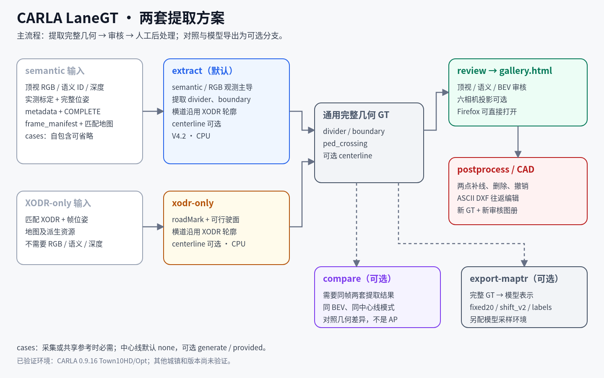
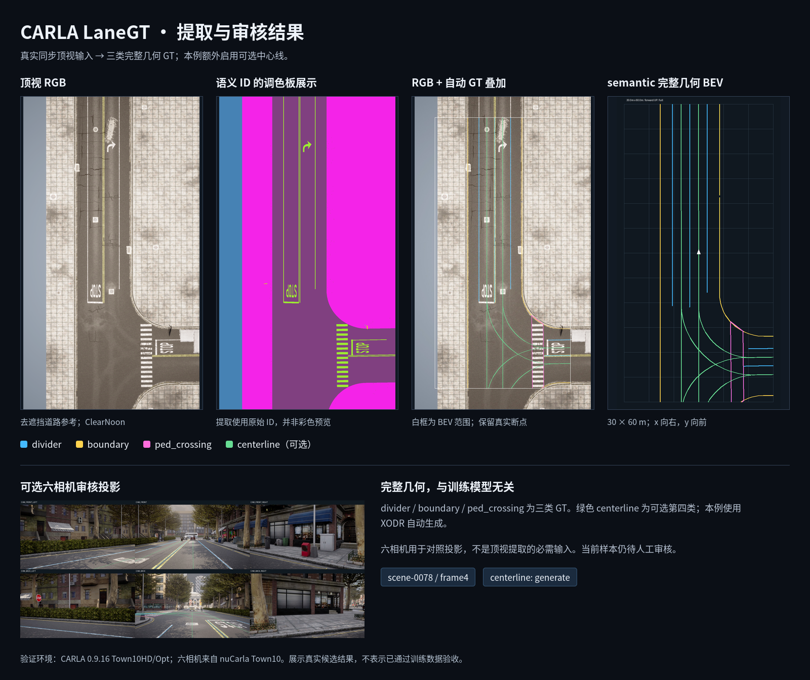
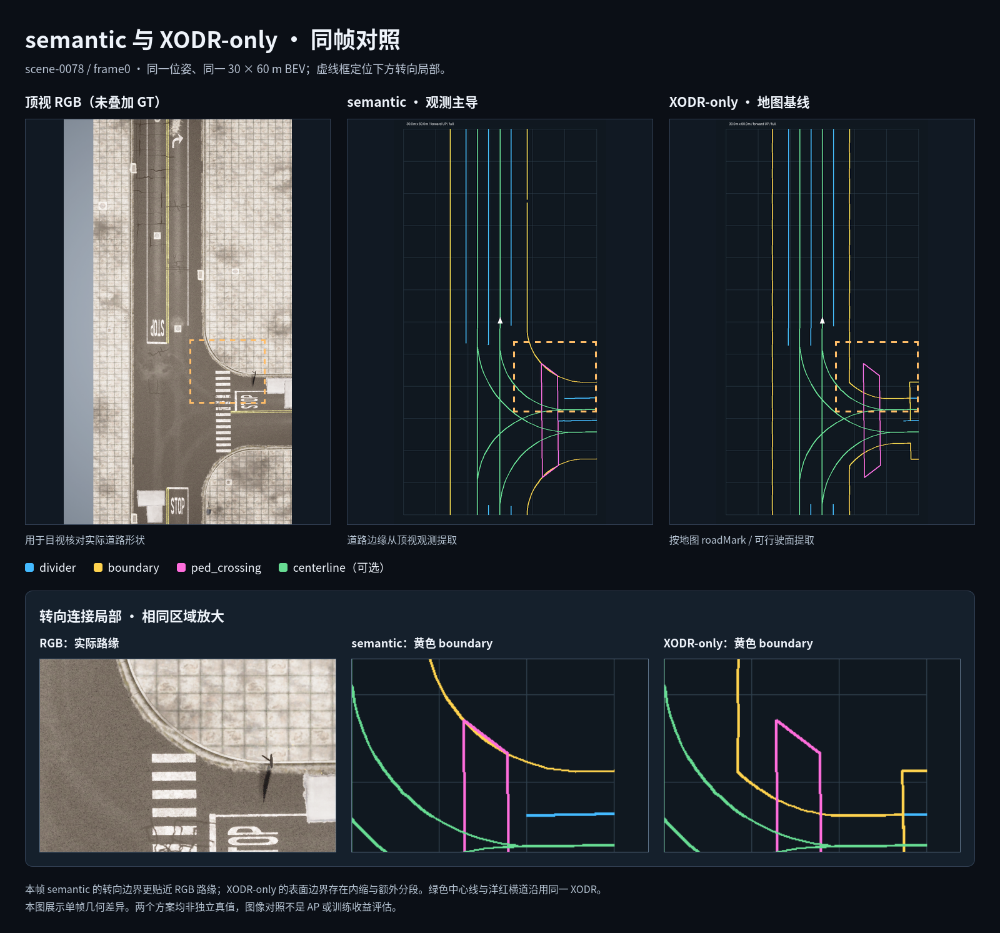
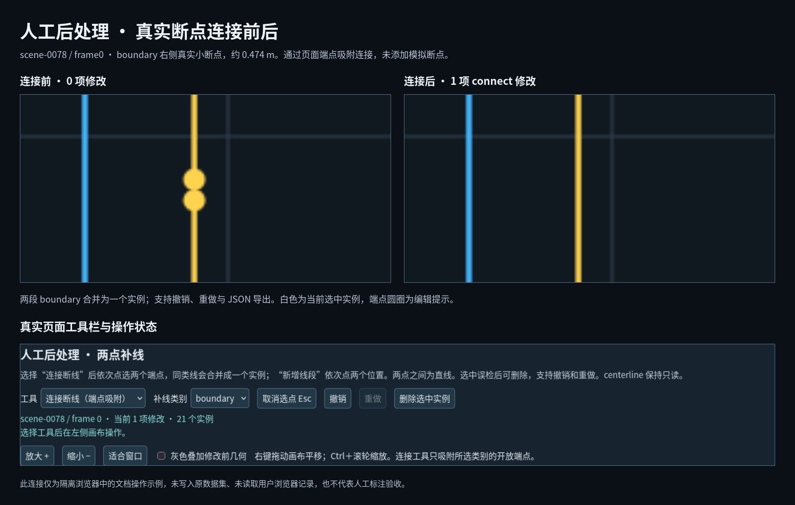

# CARLA LaneGT · Render-Grounded Road GT Toolkit

[English](README-EN.md) | 中文

CARLA LaneGT 是面向 CARLA 场景的道路矢量 GT 生成与修正工具。项目源于 MapTRv2 微调数据准备中发现的 GT 断线、几何偏移以及与 CARLA 实际渲染不一致等问题；进一步排查发现，部分问题与 XODR 几何和实际渲染之间的差异有关。项目结合匹配地图的顶视 RGB、语义 ID 图、深度数组及 XODR 辅助信息，按 GT 类型采用实际观测或地图几何提取和修正道路标注。当前支持四类 GT：`divider`（车道分隔线，支持双黄线合并中线与虚线逻辑连接）、`boundary`（道路与人行道边界）、`ped_crossing`（人行横道轮廓）和可选 `centerline`（车道中心线）。这些 GT 类型本身不限定于 MapTRv2；项目目前提供 MapTRv2 采样适配接口，内部几何结果也可作为后续适配其他矢量地图感知模型的基础。工具还提供可选的六相机投影与鸟瞰图（BEV）审核页面，并支持页面补线、审核记录导出和 CAD DXF 往返编辑。GT 提取和采样在 CPU 上执行；顶视参考采集需要 CARLA 与 GPU。

算法版本为 V4.2，软件版本为 1.0.0。**目前仅在 CARLA 0.9.16 的 Town10HD/Opt 上完成验证；其他城镇和版本尚未验证。** 默认输出通用完整几何。

采集数据不必来自 nuCarla。只需按[通用顶视接口](docs/TOPDOWN_INPUT.md)提供同步 RGB、语义 ID、深度、标定与完整 BEV 变换，并覆盖请求的 BEV 范围。可用 `tools/prepare_topdown.py` 从参考目录生成清单，无需 nuCarla 元数据表。



*流程图；六相机仅用于可选审核，compare 与模型导出为可选分支。示意图随仓库提供。*

## 已验证环境与验证数据

验证使用 CARLA 0.9.16 的 Town10HD/Opt 地图与 nuCarla Town10 六相机样本；顶视参考由本地 CARLA 采集。上述数据与地图资源不随本仓库分发，使用者需自行取得并遵守各自许可。

当前配套的资源清单、地图指纹、XODR 派生资源和采集启动配置对应这一验证环境；地图与派生数据需另行准备。接入其他城镇或版本时，需适配对应资源及采集配置并重新验证，现有脚本不能只改地图名称就直接使用。迁移检查见[地图接入与参数](docs/PARAMETERS.md#其他地图或版本的接入检查)。

## 两个提取方案

| 入口 | 方案与用途 |
|---|---|
| `python run.py extract` | 当前 V4.2 semantic 主导提取，默认方案；实际标线与道路边缘来自顶视观测，XODR 提供横道、可选中心线和有限连接辅助 |
| `python run.py xodr-only` | 复用非 semantic 几何提取代码，以 XODR roadMark、可行驶面并集和对象轮廓生成几何，作为地图基线 |

两个方案共用完整位姿、BEV、通用完整几何、可选模型采样和人工后处理接口。两套核心几何算法分别保留；不需要图像即可生成 XODR-only 几何，图册和相机投影另需匹配的图像与标定。[XODR-only 操作与方法对比](docs/XODR_ONLY.md)说明独立几何环境、可选地图几何修正和同帧对照命令。

## 结果与界面



*RGB、语义展示、GT 叠加与 semantic 完整几何 BEV；六相机仅作可选审核辅助。结果图为文档示例图，随仓库提供；原始验证数据与 GT 不随源码分发。*



*scene-0078/frame0 同帧对照与转向局部放大；差异不代表 AP 或独立真值精度。文档示例图随仓库提供。*



*页面两点补线：真实 boundary 断点连接前后；演示 profile，不写入训练 GT。文档示例图随仓库提供。*

## 功能与输入

| 功能 | 必要输入 | 结果 |
|---|---|---|
| 提取车道线 GT | 顶视 RGB、语义 ID 图、深度、标定、完整位姿、地图参考；中心线可选 | 三类或四类完整几何；可选导出模型采样 |
| 六相机审核 | 同帧六相机图像、每相机内外参和逐帧 GT | 原图拼图、GT 投影、交互式 BEV |
| 人工后处理 | 已生成图册 | 补线操作 JSON、修改后的完整几何 GT 与图册；采样可选 |
| CAD 往返 | 图册中的帧、DXF 和配套 context.json | CAD 修改预览、补线操作 JSON |

输出类别为 `divider`（双黄线合并中线、虚线逻辑连接）、`boundary`（道路与人行道边界）、`ped_crossing`（同地图 XODR 斑马线轮廓）和 `centerline`（可选自动生成或导入）。BEV 默认范围为 30×60 米，可通过 `--bev-range` 修改，要求顶视相机覆盖包含安全边缘的完整区域，x 向右、y 向前、z 向上。

对默认 semantic 方案，普通六相机照片不能单独生成本项目 GT；彩色语义展示图不能代替语义 ID 图。纯顶视模式需要准备帧位姿和顶视标定；六相机元数据与已有中心线只在对应功能启用时需要，不提供从任意原始 JPG 或视频自动生成这些输入的转换器。完整要求见[数据接口](docs/INPUTS.md)。

## 快速开始

先按当前准备情况选择入口：

| 你的情况 | 从哪里开始 |
|---|---|
| **尚无数据或匹配的地图资源** | 先按[安装说明](docs/INSTALL.md)安装几何处理环境。仓库不附带数据集和地图资源；此时只能完成环境安装，暂不能运行真实数据提取或生成审核图册。 |
| **已有符合接口要求的数据和地图资源** | 先对照[数据接口](docs/INPUTS.md)，再按[配置说明](docs/CONFIGURATION.md)设置路径、导入资源；从下面的单帧检查、提取和审核开始。完整流程见[操作指南](docs/QUICKSTART.md)。 |
| **需要重新采集顶视参考** | 先读 [CAPTURE.md](docs/CAPTURE.md)，准备匹配的 CARLA、地图资源、帧清单与 cases；先生成采集计划，确认后再显式执行采集。该入口为指定帧补采同位姿顶视参考，不是从零生成 nuCarla 六相机数据集。 |

只有 XODR 地图和位姿、尚无 semantic 顶视数据时，可以先走 [XODR-only](docs/XODR_ONLY.md) 几何基线；生成图册仍需对应图像与标定。

### 1. 安装环境（无数据也可完成）

```bash
python -m pip install -r requirements.txt
```

默认提取、审核、补线和 CAD 往返仅需几何环境及匹配的地图资源和输入数据，不需要 MapTRv2。MapTRv2 采样与 Dataset 检查为可选适配功能，见[通用 GT](docs/GENERIC_GT.md)。

### 2. 已有数据：从单帧检查到审核

以下命令针对默认 semantic 方案，需先具备对应输入与匹配资源。

```bash
cp config/paths.example.json /tmp/lanegt-paths.json
# 按 docs/CONFIGURATION.md 编辑该文件
python tools/configure.py --from-json /tmp/lanegt-paths.json
python tools/import_resources.py --from-directory /data/town10-resources
python run.py check --limit 1 --topdown-only
python run.py extract --limit 1 --topdown-only --centerline none --output outputs/extraction1
python run.py geometry-check --root outputs/extraction1
python run.py review --source outputs/extraction1 --output outputs/review1
```

用 Firefox 打开 `outputs/review1/gallery.html`。上述目录是示例：输入路径必须替换为实际数据路径，输出目录必须尚不存在。完整步骤见[操作指南](docs/QUICKSTART.md)。

## 文档

数据字段以 INPUTS/TOPDOWN_INPUT 为准，输出契约见 OUTPUTS，部署路径见 CONFIGURATION，参数值及生效位置见 PARAMETERS。使用指南中的默认示例均采用通用 GT；模型专用步骤会显式注明。

| 文档 | 内容 |
|---|---|
| [通用顶视数据接入](docs/TOPDOWN_INPUT.md) | 非 nuCarla 数据、同步标定、清单准备及旧格式兼容 |
| [通用 GT 与可选适配](docs/GENERIC_GT.md) | 无模型运行、通用标注契约、审核及按需采样 |
| [安装与环境](docs/INSTALL.md) | CPU 依赖、MapTRv2、CARLA、浏览器与 Node.js |
| [配置说明](docs/CONFIGURATION.md) | 全部路径字段、资源导入与目录保护 |
| [数据接口](docs/INPUTS.md) | 可接受图像、标签、深度、标定、位姿与文件格式 |
| [操作指南](docs/QUICKSTART.md) | 单帧、选帧、批量提取、图册与检查 |
| [输出格式](docs/OUTPUTS.md) | GT、采样 NPZ、图册、审核和补线文件 |
| [可选中心线](docs/CENTERLINES.md) | none/generate/provided、离线 XODR 生成 |
| [参数索引](docs/PARAMETERS.md) | 当前值、实际生效位置、可改性、校验限制及重采/重跑影响 |
| [BEV 范围](docs/BEV.md) | 范围配置、覆盖校验与采样/编辑一致性 |
| [顶视参考采集](docs/CAPTURE.md) | Epic、同步、去遮挡与采集结果接入 |
| [算法说明](docs/ALGORITHM.md) | 默认方案四类 GT 口径和连接规则 |
| [XODR-only 与方法对比](docs/XODR_ONLY.md) | 旧版代码复用、独立入口、同帧对照及优缺点 |
| [页面审核与补线](docs/POSTPROCESSING.md) | 端点连接、导出、应用修改和继续编辑 |
| [CAD 往返](docs/CAD_GUIDE.md) | DXF 图层、曲线、导回与命令行 |
| [常见问题](docs/TROUBLESHOOTING.md) | 输入不匹配、断线、导回冲突与环境错误 |
| [已知限制](KNOWN_ISSUES.md) | 支持范围与人工审核事项 |
| [发布说明](docs/RELEASE.md) | 公开文件范围与源码包 |

## 项目结构

`src/xodr_only/` 保存复用的历史基线与独立装配入口；`src/capture/` 负责顶视参考采集；`src/extraction/` 负责 GT 提取；`src/review/` 负责渲染和 Dataset 检查；`src/postprocessing/` 与 `web/` 负责页面和 CAD 编辑；`src/adapters/` 对接外部 MapTRv2。`config/` 保存公开参数与配置示例，`tools/` 提供配置导入和发布检查。

输入数据、地图资源、模型权重、环境配置、运行产物和人工标注均不纳入公开源码；`docs/images/` 中的少量文档示例图除外。代码采用 MIT 许可，第三方代码与资源的适用范围见[第三方说明](THIRD_PARTY_NOTICES.md)。
