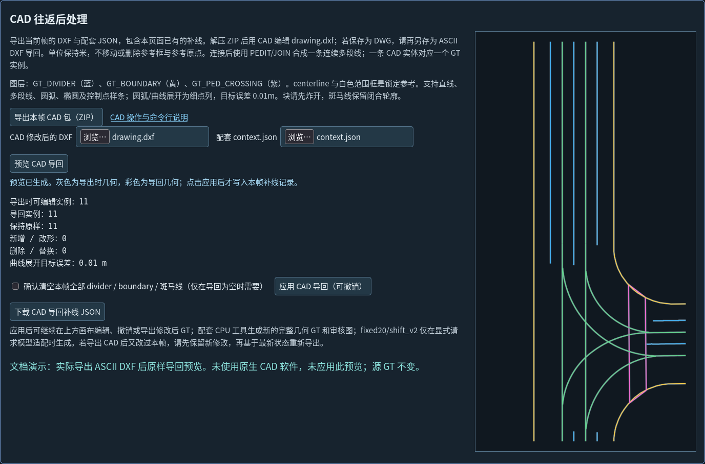

# CAD 往返后处理

默认流程使用通用完整几何 GT，无需 MapTRv2；`--sampler maptr`、`export-maptr` 和 `dataset-check` 才启用模型适配。配置与完整步骤以[通用 GT 指南](GENERIC_GT.md)为准。

CAD 用于补充复杂曲线和几何编辑。交换格式为 **ASCII DXF**，不直接读写 DWG。需要与 DXF 配套保留 `context.json`，以恢复数据集、帧、坐标、导出会话和编辑历史。

## 1. 从页面导出

1. 打开生成图册的 `gallery.html`，选择目标帧。
2. 如已有页面补线，确认其几何正确；这些修改会一起导出。
3. 在“CAD 往返后处理”区域点击“导出本帧 CAD 包（ZIP）”。
4. 解压并保留 `drawing.dxf`、`context.json` 和说明文件，不要混用不同帧或不同会话的文件。

## 2. 在 CAD 中编辑

| 图层 | 内容 | 编辑规则 |
|---|---|---|
| `GT_DIVIDER` | divider | 可新增、改形、删除或合并 |
| `GT_BOUNDARY` | boundary | 可新增、改形、删除或合并 |
| `GT_PED_CROSSING` | 斑马线轮廓 | 可修改；完整轮廓应保持闭合 |
| 中心线、范围框、原点与方向参考 | 参考几何 | 保持原位，中心线不作为可编辑 GT 导回 |

单位为米，`INSUNITS=6`，模型坐标 x 向右、y 向前，范围读取当前 GT 的 `BEV_range_m`（默认 30×60 米）。不要整体移动、旋转、镜像或缩放图形。绘图位于 XY 平面，Z=0；不把 CAD 绘图坐标当作 CARLA 世界坐标。

一条 CAD 实体对应一个 GT 实例。连接断线后使用 PEDIT/JOIN 等命令合成连续多段线；只在中间画一条独立桥接线而不合并，会新增一个独立实例。块须先炸开。斑马线原本因 BEV 裁剪而开放的轮廓可以保持开放，不会被强制封口。

保留实体的会话和来源标识。未改动实体可保留原 ID、完整 3D 点和来源；合并、拆分、重绘或新增几何可能生成新的人工实例 ID。改形点的高度由原有几何的对应/最近线段插值恢复，应在导回叠加中检查。

## 3. 保存与导回页面

保存为 AutoCAD 2000 或更新格式的 ASCII DXF。在 CAD 中使用 DWG 工作时，应另存为 DXF 后再导回。

1. 返回同一图册并选择同一帧。
2. 选择修改后的 DXF 和该次导出的原 `context.json`，点击“预览 CAD 导回”。
3. 对照灰色导出前几何与彩色导回几何，核对保留、新增/改形、删除/替换数量。
4. 确认后点击“应用 CAD 导回”；应用作为一次可撤销操作。
5. 导出补线操作 JSON，再使用 `postprocess` 生成新结果，步骤见[页面补线](POSTPROCESSING.md)。



*真实 ASCII DXF + context 的原样导回预览；未使用原生 CAD 软件，也未应用预览。文档示例图随仓库提供，原始验证数据与 GT 不随源码分发。*

导回会替换当前帧的三类可编辑几何；在 DXF 中删除的实体会从导回结果删除，其他帧和中心线保持。导回为空且原来存在可编辑实例时，须明确确认清空。导出 CAD 后又编辑了页面时，先保留新修改，再以所需版本重新导出；工具会拒绝覆盖不一致的操作历史。

## 4. 支持的实体

支持 `LINE`、`LWPOLYLINE`（含 bulge）、普通 2D/3D `POLYLINE`、`ARC`、`CIRCLE`、`ELLIPSE` 及包含控制点和节点向量的 `SPLINE`。曲线按目标误差约 0.01 米展开为点列，保留弯曲几何。

旧式拟合 POLYLINE、仅拟合点的样条、`HATCH`、`INSERT` 等需要先转换为受支持实体。遇到不支持的几何应按错误提示处理，不通过删掉实体类型或来源字段强行导入。具体 CAD 软件的 JOIN、导出编码和实体转换行为，应先使用单帧完成往返验证。

## 5. 命令行导出与导回

在仓库根目录执行；CAD 子命令的 `--source` 必须位于 `export` 或 `import` **之前**。

```bash
python run.py cad --source outputs/review1 export \
  --token FRAME_TOKEN \
  --directory /data/exports/cad_frame1
```

导出目录必须不存在。可在 `export` 参数中增加 `--patch /data/exports/geometry_edits.json`，包含该图册已有的有效补线。

```bash
python run.py cad --source outputs/review1 import \
  --dxf /data/exports/cad_frame1/edited.dxf \
  --context /data/exports/cad_frame1/context.json \
  --patch-output /data/exports/cad_geometry_edits.json
```

生成的补线操作 JSON 可以导入页面，也可以交给 `postprocess`：

```bash
python run.py postprocess \
  --source outputs/review1 \
  --patch /data/exports/cad_geometry_edits.json \
  --output /data/lanegt/manual_cad_v1
```

导回命令也支持增加 `--output /data/lanegt/manual_cad_v1`，直接保存通用完整几何并渲染新图册，无需 MapTRv2。若需要模型采样，先生成通用结果，再单独 export-maptr；CAD import 本身没有 --sampler 参数。补线 JSON、其 `.report.json` 和新结果目录都必须尚不存在。确实需要清空所有可编辑几何时，显式使用 `--allow-empty`。

命令行通过 Node.js 18+ 运行 DXF 桥接模块；页面 DXF 导入导出不需要 Node.js 服务。支持的实体见本文说明；正式批量处理前，应在所用 CAD 软件中完成单帧往返并核对导回几何。
