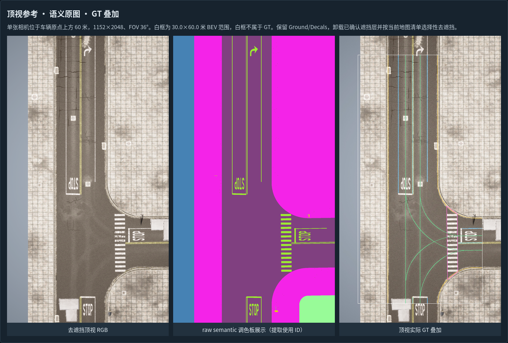

# CARLA 顶视参考采集

采集器按通用帧清单和显式 cases，为指定地图、指定完整位姿采集顶视 RGB/semantic/depth。无需 nuCarla 原始表或六相机图像；六相机仅用于可选审核。它不自动规划路线或生成六相机数据集。输入要求见[通用顶视接口](TOPDOWN_INPUT.md)。

## 准备

1. 配置已验证 CARLA_0.9.16 的 `carla_root`、`carla_python`。
2. 导入通过指纹校验的 Town10 资源。
3. 准备帧清单和 cases；`center_xy`、`capture_z`、`capture_yaw` 使用测量坐标，不能仅以帧号或近邻位置替代。
4. 保证采集使用的 CARLA 服务端口未占用。采集器使用 2070/2071/2072 端口，拒绝接管已有服务。

## 计划与执行

```bash
python run.py collect-plan --limit 1
python run.py collect-plan --selection selection.json
```

计划操作不启动 CARLA、GPU 或传感器。检查地图、相机参数、目标参考列表和去遮挡方案后，显式执行：

```bash
python run.py collect \
  --selection selection.json \
  --output /data/lanegt/capture_run1 \
  --execute
```

输出目录必须不存在。只有 `--execute` 会启动采集进程；`collect-plan` 不允许携带该参数。

## 采集参数与去遮挡

- 服务器地图：匹配的 `Town10HD_Opt`，Epic 画质，顶视使用 ClearNoon。
- 最终参考：距车辆原点上方约 60 米、1152×2048、FOV 36°、垂直向下。
- RGB、SEMANTIC、DEPTH 采用同步采集，并记录实测内外参、传感器帧号和时间戳。
- 采用 `C_more_layers` 分层去遮挡配置，保留 Ground/Decals，卸载配置中的确认遮挡层；对清单中的确认对象选择性隐藏。
- 采集过程先执行 1280×1280、FOV 65° 的校准对照，再重新分配最终参考传感器；校准图不是最终 GT 输入。
- 显存停止阈值为 7400 MB，监控触发值为 7057 MiB；服务器采用冷启动，只结束本任务创建的进程。

指定地图的可见性接口、对象名称/位置和指纹属于采集契约。该方法不能不经验证直接套用其他 CARLA 构建或任意对象列表。

BEV 变大不会自动提高相机。需要扩大有效覆盖时，应调整 cases 中的测量采集位置与 `capture_z` 后重新采集，并用 `check --bev-range ...` 检查。现有采集器最终传感器仍在代码中固定为 1152×2048、FOV 36°；cases 中 capture_size/capture_fov_deg 仅是描述字段，不控制传感器。修改须按[参数索引](PARAMETERS.md)联动实现后重新采集。

## 采集结果接入提取

结果保存于 `<采集输出>/topdown_cases/<case_id>/`，每个完整参考包含 RGB、语义 ID/展示图、深度、元数据和 `COMPLETE.json`。进度与采集证据在该输出的 `reports/`、`evidence/`、`runtime/` 中。



*图中 GT 叠加是后续提取结果，不是采集原图；文档示例图随仓库提供，原始验证数据与 GT 不随源码分发。*

采集完成后：

1. 检查执行状态、参考完整性、同步证据、完整位姿与地图指纹。
2. 将环境配置中的 `topdown_root` 指向新的 `<采集输出>/topdown_cases`；使用与该次采集一致的 cases 和对应通用帧清单。
3. 无六相机时运行 `python run.py check --selection selection.json --topdown-only`；启用六相机时再去掉该选项并准备相机输入。
4. 先提取单帧、生成图册并检查覆盖和投影，再进行批量提取。

工具不会自动改写提取配置或将新图像接入已有图册。采集目录属于运行数据，不纳入源码发布。

目前仅在 CARLA 0.9.16 的 Town10HD/Opt 上完成验证；其他城镇和版本尚未验证。当前默认资源和采集配置对应这一验证环境，接入其他地图须先适配并验证，不能仅改名称或摘要。相机、BEV、提取、分段和导出参数的实际生效位置及修改影响见[参数索引](PARAMETERS.md)。
