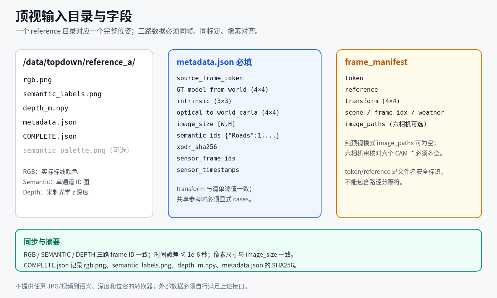
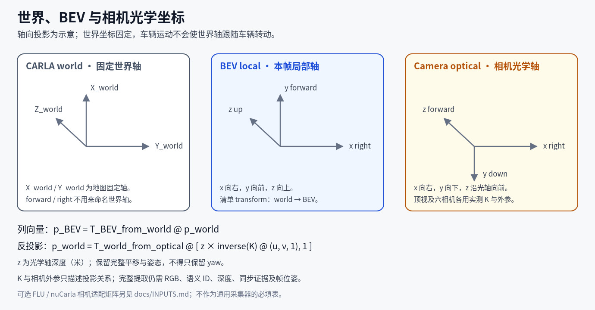

# 数据接口

接口使用 UTF-8 JSON；`.json.gz` 为 gzip 压缩 JSON。长度单位米，图像尺寸按 `[宽,高]`，矩阵为列向量变换。目前仅在 CARLA 0.9.16 的 Town10HD/Opt（采集使用 Opt）上验证，其他城镇和版本尚未验证。当前配套资源来自该验证环境，脚本仍按清单检查地图指纹。

数据来源不限 nuCarla，默认流程不需要 MapTRv2。首次接入建议从[通用顶视数据](TOPDOWN_INPUT.md)及 `tools/prepare_topdown.py` 开始。下列图像要求属于默认 semantic 提取；XODR-only 的例外见文末。

## 必要和可选输入

| 输入 | 使用条件 |
|---|---|
| 帧清单、完整 BEV-from-world 变换 | 两方案逐帧提取均必需；不是单独 yaw 或车辆位置 |
| 顶视 RGB、语义 ID、深度、内外参、同步证据及 COMPLETE | semantic 必需；不能仅用普通照片或展示图 |
| 匹配 XODR 及派生地图资源 | XODR 横道、连接辅助和可选中心线所需；清单见[配置](CONFIGURATION.md) |
| cases | 自包含通用顶视元数据时可省略；声明共享参考代表帧或重新采集时使用 |
| 六相机图片与各自元数据 | 仅启用六相机审核/模型图像 Dataset 时需要；无相机用 `--topdown-only` |
| 已有中心线标签 | 仅 `--centerline provided`；默认 none 不读取，generate 离线生成 |
| 模型环境 | 仅可选 MapTRv2 采样、导出及 Dataset 检查 |

## 图像、语义与深度

| 文件 | 格式与用途 |
|---|---|
| `rgb.png` | RGB，数组 `(H,W,3)`，用于实际标线颜色 |
| `semantic_labels.png` | 单通道语义 ID，数组 `(H,W)`；Roads=1、Sidewalks=2、RoadLines=24 |
| `depth_m.npy` | 米制光学 z 深度，推荐 float32，数组 `(H,W)` |
| `semantic_palette.png` | 可选 RGB/RGBA 展示图；缺少时由 ID 图生成审核预览，不参与提取 |

三路必须像素对齐、同帧同步、同光学参数与位置。其他语义编码应先正确转换，不能只改 `semantic_ids` 或依赖显示颜色。改变分辨率/裁剪/旋转必须同步更新标定；不提供任意 JPG/视频到语义、深度和位姿的预测器。

深度反投影约定：

```text
ray = inverse(K) @ [u,v,1]
p_optical = depth_m[v,u] * ray
p_world = optical_to_world_carla @ [p_optical.x,p_optical.y,p_optical.z,1]
```

不能直接使用归一化深度或未经换算的射线距离。现有采集代码将 CARLA 编码深度按 `1000*(R+256*G+65536*B)/16777215` 解码保存；原 BGRA 缓冲区须按正确通道读取。

已验证最终顶视为 1152×2048、水平 FOV 36°、约车辆上方 60 米、竖直向下。提取接口依据实际 K、外参、尺寸和完整地面 ROI 检查覆盖，不将该分辨率作为所有外部采集器的唯一格式；其他参数组合仍须小样本验收。相机位于 z=0 地面上方，旋转正交、光轴近竖直向下（外参 `[2,2]≤-0.999`）、平方像素 `fx≈fy>0`。四周默认保留 48 像素安全边缘。相机/地面假设及固定常量见[参数索引](PARAMETERS.md)。

## 帧清单



*示意图；目录与字段关系。*

`frame_manifest` 是 JSON 数组：

| 字段 | 含义 |
|---|---|
| `token` | 唯一稳定帧标识，作为单个文件名；推荐字母、数字、下划线、点或短横线，不能含目录分隔符或为 `.`/`..` |
| `reference` | `topdown_root` 下参考目录名 |
| `transform` | 有限 4×4 世界到本帧 BEV 变换，保留完整姿态与平移 |
| `scene`、`frame_idx`、`weather` | 图册筛选字段；prepare_topdown 可生成通用默认值 |
| `image_paths` | 纯顶视可为空；六相机模式为各通道图片绝对路径 |

示例仅展示结构，矩阵必须替换为实际测量值：

```json
[
  {
    "token":"capture_000001",
    "reference":"reference_a",
    "scene":"topdown",
    "frame_idx":0,
    "weather":"unspecified",
    "transform":[[1,0,0,0],[0,1,0,0],[0,0,1,0],[0,0,0,1]],
    "image_paths":{}
  }
]
```

## 顶视 metadata 与 COMPLETE

| metadata 字段 | 约定 |
|---|---|
| `source_frame_token` | 通用来源帧标识；没有 cases 时等于清单 token |
| `GT_model_from_world` | 与清单 transform 逐值一致；新通用输入必需，字段名为兼容保留，与模型安装无关 |
| `intrinsic` | 3×3 实测 K |
| `optical_to_world_carla` | 4×4 实测光学相机到 CARLA 世界变换 |
| `image_size` | `[W,H]`，与实际数组一致 |
| `semantic_ids` | `{"Roads":1,"Sidewalks":2,"RoadLines":24}` |
| `xodr_sha256` | 与当前资源一致 |
| `sensor_frame_ids` | RGB/SEMANTIC/DEPTH 三个相同的非负整数帧号 |
| `sensor_timestamps` | 三路有限秒时间戳，跨度≤1e-6 秒 |
| `case_id` | 可选；若存在必须等于 reference |
| 其他采集记录 | map_name、weather、实测三传感器位姿、质量/去遮挡证据等，按实际记录保留 |

旧 `nuCarla_frame` 作为来源帧名的兼容别名；两字段冲突会拒绝。旧输入按已有兼容规则读取，新通用输入不得省略完整变换或同步证据。

`COMPLETE.json` 的 `files` 至少记录 `rgb.png`、`semantic_labels.png`、`depth_m.npy`、`metadata.json` 的真实 SHA256。可选预览若列入摘要也必须存在并匹配。元数据或图像变化后须更新摘要；摘要不是同步或几何正确性的替代证明。

## cases：参考共享与采集

普通自包含参考无需 cases。多个帧共享参考时，必须具有完全相同的 transform，并在 cases JSON 数组中明确代表帧：

| 字段 | 作用 |
|---|---|
| `case_id` | 对应 reference |
| `frame.token`、`frame.transform` | 代表帧及完整变换；来源 token 与代表帧一致，使用者 transform 逐值匹配 |
| `center_xy`、`capture_z`、`capture_yaw` | 重新采集时的相机世界位置、绝对 z 与偏航 |
| `capture_height_m`、`capture_size`、`capture_fov_deg` | 描述字段，不等于传感器控制入口；实际生效位置见参数索引 |

禁止用最近位置/朝向替代完整位姿。`capture_z` 不是相对车辆高度，不能用描述性 height 字段代替它。

## 可选六相机适配

配置接受 `camera_metadata` / `camera_images`，旧名 `native_metadata` / `native_images` 继续兼容。元数据文件为 `<token>.json.gz`，图像按 `CAM_*` 分目录，清单与元数据的 `image_path` 应一致。

| 字段 | 作用 |
|---|---|
| `token`、`scene_token`、`timestamp_us` | 帧、场景、时间身份 |
| `native_to_world_flu` | 4×4 相机载体/原生车辆 FLU 到世界 FLU 变换 |
| `cameras.<CAM_*>.image_path` | 图片绝对路径 |
| `cameras.<CAM_*>.intrinsic` | 对应图片的 K |
| `cameras.<CAM_*>.optical_to_native` | 相机光学坐标到载体 FLU 的完整外参 |
| `width`、`height`、`sensor_to_world_carla` | 原尺寸和采集位姿证据，建议保留 |

六个通道为 CAM_FRONT、CAM_FRONT_LEFT、CAM_FRONT_RIGHT、CAM_BACK、CAM_BACK_LEFT、CAM_BACK_RIGHT。图册显示顺序为前左/前/前右、后左/后/后右；模型顺序由适配器决定。原图可用 JPEG/PNG；当前可选 MapTR 图像 Dataset 检查要求六张 1600×900、queue_length=1，不能据此宣称其他尺寸、布局或时序训练已验收。

nuCarla 是已验证的相机/历史数据适配，不是顶视来源要求。六相机审核用各自实测矩阵，不重新推断标定或去畸变。

## 坐标系

基础 GT 为 BEV 局部 x 右、y 前、z 上，世界输入采用 CARLA 约定。使用列向量 `p_target=T_target_from_source@p_source`。清单 transform 为 world→BEV，不是车辆→world。跨手性坐标变换可能包含反射，不能只保留 yaw 或忽略 z/pitch/roll。

可选原生 FLU 相机适配令 `E=native_to_world_flu`、`S=diag(1,-1,1,1)`、`N=[[0,1,0,0],[-1,0,0,0],[0,0,1,0],[0,0,0,1]]`，则 `T_BEV_from_CARLA=inverse(N)@inverse(E)@S`。该关系用于相机/模型适配校验，不要求普通顶视采集器提供 nuCarla 表。BEV 点转相机光学坐标时用 `inverse(optical_to_native)@N`。



*示意图；world 轴固定，车辆/传感器局部轴与相机光学轴需用外参转换。*

## 可选已有中心线

`centerline_labels`（旧 `native_labels`）仅用于 `--centerline provided`。每个 `<token>.json.gz` 包含 `classes.centerline`，实例至少有 id、parent_id、render_points(N×2)、render_xyz(N×3)、source；坐标已在本帧 BEV 中。默认 none 不读取；generate 从匹配 XODR 生成。

扩大 BEV 时旧标签不能补出原范围以外的几何。导入保留完整几何/来源，通用输出会将模型采样 points 规范为 null；不要把“沿用输入”理解为所有元数据逐字节不变。中心线只读，详见[CENTERLINES](CENTERLINES.md)。

## XODR-only 与检查顺序

XODR-only 的世界生成只需匹配 XODR；逐帧几何需要世界缓存、清单和完整变换，不读取 RGB/语义/深度。生成顶视图册另需同位姿顶视 RGB、标定与元数据；没有语义图时显示未提供提示。默认同样不需要模型采样。具体见[XODR-only](XODR_ONLY.md)。

默认步骤为 `check` → 单帧 `extract` → `geometry-check` → `review` → 人工审核。只有请求 MapTR 适配时才在新导出图册上运行 `dataset-check`。check 是文件/元数据预检查，不证明所有像素或 GT 已正确。
