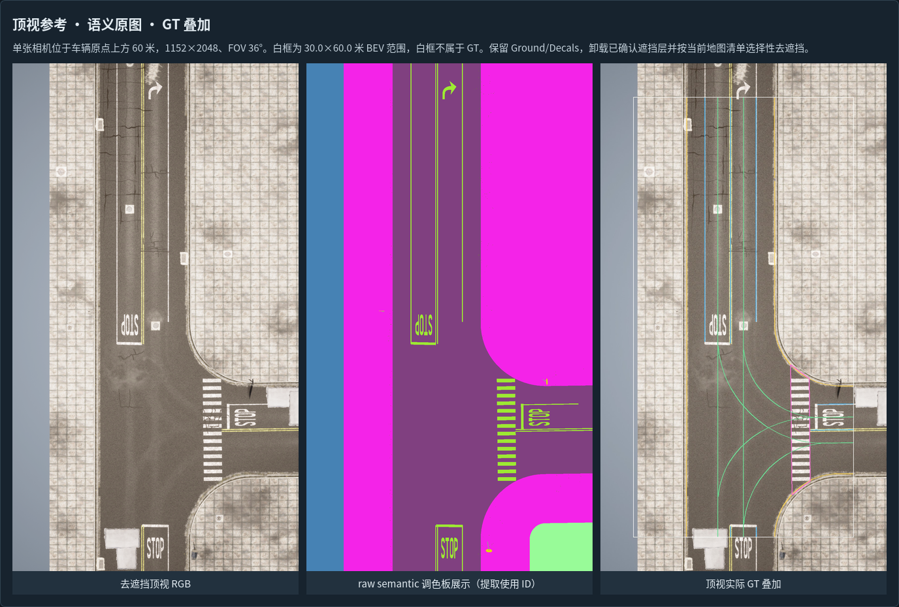
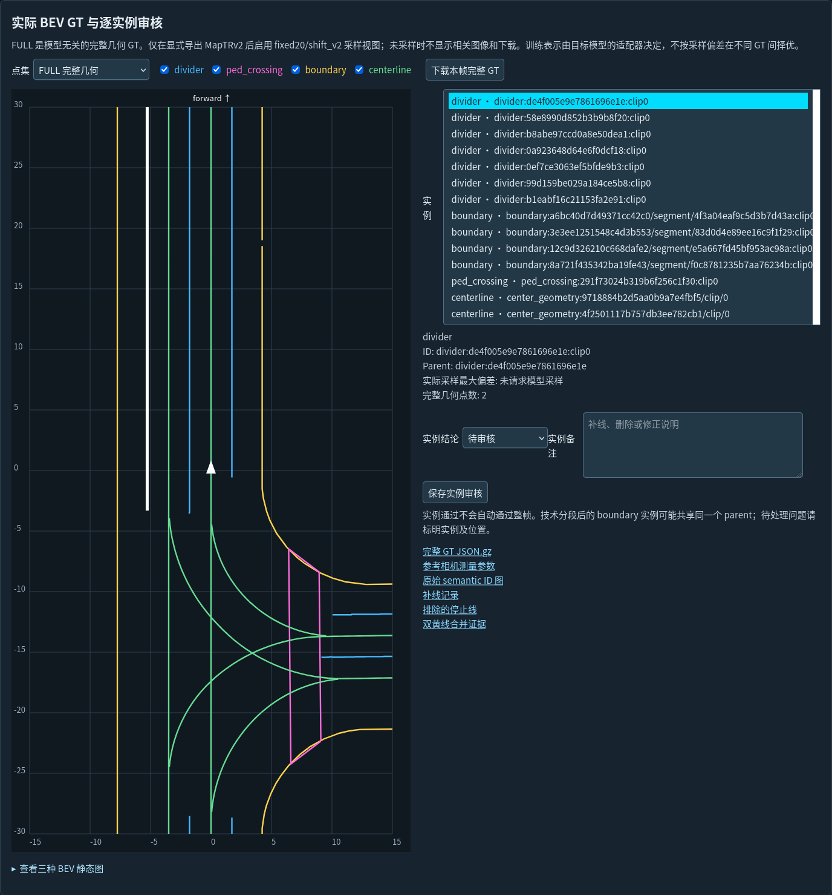

# 输出格式与状态

默认输出是模型无关的完整几何 GT，三类/四类口径见[算法](ALGORITHM.md)。MapTRv2 训练点集是可选附加表示，不能代替完整几何，也不改变基础 GT 的来源或人工审核要求。

## 提取目录

```text
extraction/
├── manifest.json
├── SUMMARY.json
├── geometry/<reference>/
│   ├── candidates.json
│   ├── audit.json
│   └── reference_manifest.json
└── frames/<token>/
    ├── gt.json.gz
    ├── targets.json.gz
    ├── sampling_diagnostics.json
    └── input_binding.json
```

semantic 还保存观测 mask、boundary 证据和地图诊断；XODR-only 另保存 `world.json`。`centerline generate` 的 semantic 提取保存 `centerlines_world.json`，XODR-only 的中心线在其世界缓存内。

`geometry/` 是参考范围/世界坐标候选与观测审计；最终采用的逐帧范围及完整几何以 `frames/<token>/gt.json.gz` 和 targets 为准。人工后处理改变逐帧标注，不将旧观测证据重写成人工结果。

## 基础 GT 契约

默认 `schema=lanegt_geometry_v1`；`geometry_schema` 同为 `lanegt_geometry_v1`，`sampling_backend=none`、`actual_sampler_applied=false`。记录 token、reference、class_order、classes、counts、BEV_range_m、units=metres 和 coordinate_convention=x_right_y_forward_z_up。

| 实例字段 | 作用 |
|---|---|
| `id` / `parent_id` | 实例标识与来源父实例 |
| `render_points` | 完整可变点数 XY 折线 |
| `render_xyz` | 一一对应的完整 XYZ 折线 |
| `points` | 默认 null；仅对应模型采样存在时可能有值，不是基础几何 |
| `source` | 观测/地图/人工处理来源；导入历史记录可保留其来源结构 |
| 审核状态字段 | 默认未批准，不由技术检查自动通过 |

类别数组为 divider、ped_crossing、boundary、centerline。中心线 none 时保留空数组，含义为不提供其监督；下游应同步配置类别，不将未知中心线当作四类模型的负样本。

`targets.json.gz` 保存稳定目标顺序，包含 id、parent_id、class_name、full（完整XY）、full_xyz、source。模型诊断才添加 fixed、worst、sampling_hd_m；不可重排 targets 后直接复用旧 NPZ 行号。

通用 GT 不以 128 query 限制实例数。`capacity_check_scope` 明确对应可选 MapTRv2 适配；仅在实际采样时检查该容量，超限标记不会静默截断数据。

## 可选 MapTRv2 表示

显式 `--sampler maptr` 或 `export-maptr` 后生成 `actual_sampler_targets.npz`，并记录 `sampling_backend=maptr`、`actual_sampler_applied=true`。

| 数组 | 形状与含义 |
|---|---|
| target_ids | `(N,)`，与 targets 顺序对应 |
| fixed20 | `(N,20,2)`，实际每实例20点 |
| shift_v2 | `(N,19,20,2)`，实际点序变体，含无效占位编码 |
| labels | `(N,)`，divider=0、ped_crossing=1、boundary=2、centerline=3 |

无效 shift 占位不得当地图坐标使用。最坏合法变体仅作表示偏差诊断，不是模型预测，也不在多套 GT 中择优。超过0.20米的表示偏差进入提醒，不能解释为 AP。

直接启用采样的旧接口可能保留 `maptrv2_semantic_gt_v1` / `maptrv2_xodr_gt_v1` schema；从通用 GT 导出时可继续保留通用 schema。应根据 geometry_schema、sampling_backend、actual_sampler_applied 和文件绑定判断表示，不能只按 schema 字符串猜测。

默认未请求采样时，诊断记录为未请求/未运行状态，不生成伪造 NPZ。MapTR 导出写新目录，保留完整几何与实例身份。

## 图册

review 从原始提取生成帧/几何副本，加入 gallery.html、audit、editor_data、manifest/frames.json、project.json、SOURCE_FILES_SHA256.json 和操作文档。

| 图像 | 生成条件 |
|---|---|
| six_camera_raw.jpg / six_camera_gt.jpg | 六相机原图/投影；纯顶视为明确未提供相机的提示图 |
| topdown_gt.jpg / bev_gt.png | 顶视 GT 叠加和完整几何 BEV |
| semantic_preview.png | 优先使用可选展示图，否则由 ID 图生成；XODR-only 无语义输入时提示未提供 |
| bev_fixed20.png / bev_shift_v2_worst.png | 仅实际采样帧生成，未采样时页面禁用相应视图/下载 |



*顶视参考、语义展示与 GT 叠加。*



*完整 BEV、实例列表与审核控件。文档示例图随仓库提供，原始验证数据与 GT 不随源码分发。*

`topdown_cases`、`native_images` 为外部输入链接。重建已有图册或人工后处理还可能复用源帧链接；不要在未检查依赖时删除/移动输入或源图册。图册不是自包含源码分发包。

## 审核、补线与 CAD 导出

| 导出类型 | 用途 | 能否直接交给 postprocess |
|---|---|---|
| 审核 JSON/CSV | 帧/实例结论、备注 | 否 |
| 补线操作 JSON | 有序新增、连接、删除、CAD 操作 | 是 |
| 修改后单帧完整 GT JSON | 查看或交换当前几何 | 否，不代替操作历史 |
| CAD DXF + context.json | 配套的 CAD 编辑与导回 | 先导回为补线操作 |

补线/CAD 的 `maptrv2_*` schema 名称为兼容保留，不意味着依赖 MapTR。它们绑定 dataset_id、manifest_sha256、token、base_gt_sha256，CAD 还绑定会话和导出几何，不能改摘要绕过冲突。

postprocess 默认保存修改帧的通用完整几何并重绘图册，不采样；显式 `--sampler maptr` 才采样。未修改帧可链接保留原表示。`edits/APPLIED_PATCH.json` 和 `reports/MANUAL_APPLY.json` 记录执行；技术完成不自动设置 approved_for_training=true。

## 检查与方案比较

`geometry-check` 对原始提取或图册作只读格式/几何检查，无模型依赖。`dataset-check` 仅检查已准备好实际采样的可选 MapTR 输出：纯顶视时检查向量与实际采样，六相机时另生成 Dataset 索引并检查少量 DataLoader；review60 文件名是兼容名称，不限制帧数。

`compare` 写新的 gallery.html、images 和 comparison.json，只在地图、帧、位姿、相机绑定、中心线模式与 BEV 一致时比较完整几何。实例数、长度及双向包络覆盖是结果差异，不是独立真值精度或模型AP，详见[XODR-only](XODR_ONLY.md)。
