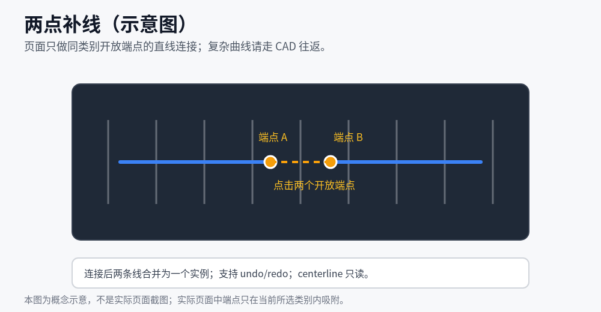
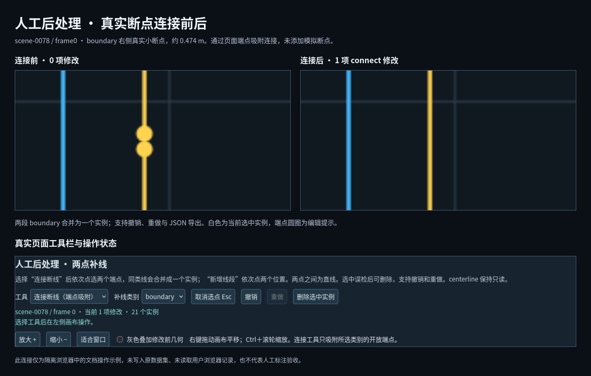

# 页面审核与人工补线

默认流程使用通用完整几何 GT，无需 MapTRv2；`--sampler maptr`、`export-maptr` 和 `dataset-check` 才启用模型适配。配置与完整步骤以[通用 GT 指南](GENERIC_GT.md)为准。

先按[操作指南](QUICKSTART.md)生成图册，再用 Firefox 打开其中的 `gallery.html`。页面提供审核、几何编辑和 CAD 三个相关但独立的区域。

## 1. 选择帧并审核

按场景、天气或帧列表选择目标帧，对照六相机原图/GT 投影、顶视 RGB/语义图/GT 叠加及 BEV。`FULL` 为完整几何；仅有实际采样时启用 `fixed20` 和 `shift_v2 worst` 诊断，未采样时不显示相应静态图或下载。

在实例列表或 BEV 上选择实例，填写审核结论与备注；使用审核区域的导出功能保存 JSON/CSV。审核 JSON 用于恢复结论，不能直接传给 `postprocess` 生成新几何。记录的具体用途见[输出格式](OUTPUTS.md)。

白色高亮表示选中实例，白色范围框和车辆方向标记是参考图形；灰色叠加表示修改前几何，均不是新增 GT。

## 2. 在页面连接断线

1. 滚动到“人工后处理 · 两点补线”，等待当前帧数据加载完成。
2. 选择补线类别：蓝色标线选 `divider`，黄色道路边界选 `boundary`。
3. 选择“连接断线（端点吸附）”，依次点击两个开放端点。
4. 核对修改后 BEV 和实时顶视叠加，必要时撤销或重做。

连接只吸附所选类别的开放端点，连接后两条线合并为一个实例，两点之间使用直线。若端点太近难以选择，可先放大；右键拖动平移，Ctrl＋滚轮缩放，Esc 取消选点。同一类线的连接不应跨越隔离区或连接到其他道路对象。



*概念示意：点击两个开放端点，直线连接并合并为一个实例。*



*实际 gallery 中 scene-0078/frame0 的 boundary 断点连接前后；演示 profile，不写入训练 GT。文档示例图随仓库提供，原始验证数据与 GT 不随源码分发。*

## 3. 新增、删除和曲线编辑

“新增两点线段”依次点击两个位置，生成当前所选类别的直线。选中实例后可删除；操作支持撤销/重做。`centerline` 为只读。

页面两点工具适合短断口和直线修补，不会自动生成合理转弯弧线。需要调整较长曲线、合并复杂轮廓或修改斑马线时，使用[CAD 往返](CAD_GUIDE.md)。不要用一条长直线替代明确可见的弯道。

## 4. 保存编辑和备份

编辑自动保存到浏览器存储，仍应点击“导出全部补线 JSON”保存操作文件。自动保存受浏览器、文件位置与数据集身份影响，不是共享数据文件。

“下载本帧修改后 GT JSON”包含当前几何，用于查看或交换；它不代表已经重新生成实际采样，也不能替代补线操作 JSON。静态六相机投影和图片仍用于对照编辑前 GT，只有实时编辑画布立即显示人工修改。

换浏览器或图册位置前，应分别导出审核记录和补线操作。在同一数据集的相应入口分别导入；不要将审核 JSON 导入补线入口。新提取结果或新人工结果使用不同的数据集身份，不能强行套用旧操作文件。

## 5. 应用补线并生成新的结果

在仓库根目录执行：

```bash
python run.py postprocess \
  --source outputs/review1 \
  --patch /data/exports/geometry_edits.json \
  --output /data/lanegt/manual_v1
```

`--source` 指向补线文件所绑定的图册，必须包含 `gallery.html` 对应的数据集索引与逐帧文件；`--patch` 指向补线操作 JSON；`--output` 是尚不存在的新目录。路径应避开现有数据目录及其子目录，详见[配置与保护规则](CONFIGURATION.md)。

工具先验证数据集身份、清单、原 GT 摘要和操作，再为修改帧按源 GT 范围保存通用完整几何、重绘顶视叠加和 BEV；仅显式 --sampler maptr 时运行实际模型采样，有相机输入时附加六相机投影。未修改帧复用源数据，中心线保持。结果中的 `edits/APPLIED_PATCH.json` 与 `reports/MANUAL_APPLY.json` 记录应用内容。

打开 `/data/lanegt/manual_v1/gallery.html` 继续审核和编辑。继续应用下一批修改时，`--source` 必须指向该新结果，不能仍指向第一轮源图册。源图册及外部图片/顶视数据应保留，因为新结果可能包含链接。

## 6. 冲突处理

遇到数据集或 GT 摘要不匹配时，核对操作文件来自哪个图册；遇到 CAD 导出后的历史冲突时，先导出并保留当前编辑，再基于正确版本重新导出 CAD。不要修改哈希、删除浏览器记录或覆盖源 GT 来绕过冲突。

未发生有效编辑的空补线文件不能生成新结果。几何修改不会自动将审核结论改为通过，也不会自动设置训练批准状态。
