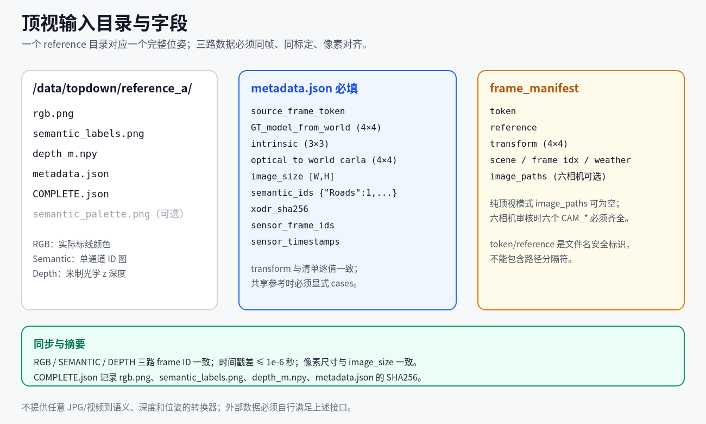

# 通用顶视数据接入

semantic GT 提取不要求数据来自 nuCarla。任意采集器都可以提供本接口约定的同步顶视数据；nuCarla 是已有的可选六相机与历史数据适配方式。目前仅验证 CARLA 0.9.16 的平面 Town10HD/Opt；其他城镇和版本尚未验证。通用输入接口与验证数据来源分别说明；当前仍检查配套资源指纹，接入其他地图需要相应适配。

## 最小输入

```text
/data/topdown/
└── reference_a/
    ├── rgb.png
    ├── semantic_labels.png
    ├── depth_m.npy
    ├── metadata.json
    └── COMPLETE.json
```

RGB、语义 ID 和深度必须像素对齐、使用相同标定、属于同一同步时刻。语义 ID 必须按当前 Roads=1、Sidewalks=2、RoadLines=24 转换；彩色展示图不能代替 ID 图。深度是米制相机光学 z 深度，细节见[数据接口](INPUTS.md)。`semantic_palette.png` 是可选预览；缺少时审核渲染器由 ID 图生成显示，不改变原标签。

`metadata.json` 必须包含：

| 字段 | 含义 |
|---|---|
| `source_frame_token` | 与数据来源无关的稳定帧标识，例如 `capture_000001` |
| `GT_model_from_world` | 4×4 世界到目标 BEV 坐标变换，保留完整平移/旋转；字段名为兼容保留，与模型安装无关 |
| `intrinsic` | 实测顶视光学相机 K，3×3 |
| `optical_to_world_carla` | 实测光学相机到 CARLA 世界变换，4×4 |
| `image_size` | `[W,H]`，与输入数组一致 |
| `semantic_ids` | `{"Roads":1,"Sidewalks":2,"RoadLines":24}` |
| `xodr_sha256` | 当前匹配地图的指纹 |
| `sensor_frame_ids` | `{"RGB":100,"SEMANTIC":100,"DEPTH":100}`，同一采集同步组的整数标识 |
| `sensor_timestamps` | `{"RGB":10.0,"SEMANTIC":10.0,"DEPTH":10.0}`，同步时间戳，单位秒 |

示例帧号和时间仅展示格式，实际须来自采集记录。三路 frame ID 必须一致，时间戳差不得超过 1e-6 秒。可选字段 `case_id` 若提供，必须等于顶视子目录/清单 reference；`scene`、`frame_idx`、`weather` 可供图册筛选，不提供时由准备工具填入通用默认值。

相机必须满足现有近垂直顶视和平方像素假设；BEV 地面区域四角须位于图像四周 48 像素安全边缘内。默认 30×60 米，使用 `--bev-range` 修改。只放大图像尺寸或只提供一张覆盖范围足够的 RGB 图，不足以代替深度、语义及标定。

`COMPLETE.json` 使用 `files` 对象记录上述四个数据文件的实际 SHA256，至少包含 `rgb.png`、`semantic_labels.png`、`depth_m.npy`、`metadata.json`。若额外记录了预览等文件，提取时也核对其摘要。元数据变更后须重新计算其摘要，不能继续沿用旧清单。



*与 INPUTS 复用同一图；目录和字段以本文及数据接口为准。*

## 从顶视目录开始

在安装好 `requirements.txt` 的几何环境中执行：

```bash
python tools/prepare_topdown.py --topdown-root /data/topdown \
  --output /data/prepared_metadata
python tools/configure.py --from-json /data/prepared_metadata/paths.json
python tools/import_resources.py --from-directory /data/town10-resources
python run.py check --limit 1 --topdown-only
python run.py extract --limit 1 --topdown-only --centerline none --output outputs/gt1
python run.py review --source outputs/gt1 --output outputs/review1
```

准备工具只读取现有数据，验证绑定、同步、地图、标定、覆盖与文件摘要，生成 `frames.json` 和 `paths.json` 草稿，不采集图像、不推断位姿、不启动 GPU。原数据不改写。非默认 BEV 时，准备、检查、提取三个步骤显式使用相同 `--bev-range`。输出目录必须尚不存在。

没有六相机时使用 `--topdown-only`。没有 MapTRv2 也可运行全部通用提取与审核流程，见[通用 GT](GENERIC_GT.md)。中心线仍可选生成，斑马线和有限连接辅助仍依赖匹配的 XODR 资源。

## 手工帧清单及旧数据兼容

可以直接提供既有格式的 `frame_manifest`，必需 `token`、`reference`、`transform`；图册还使用 `scene`、`frame_idx`、`weather`，准备工具可自动生成这些字段。`transform` 必须与元数据 `GT_model_from_world` 逐值一致。

通常无需 `cases`：每个顶视参考的 `source_frame_token` 与对应行 `token` 相等。若多个帧共享同一完整位姿参考，显式提供 cases 表声明代表帧；其 transform 必须与每个使用者逐值一致。不能用最近位置或最近 yaw 替代完整位姿。

历史元数据 `nuCarla_frame` 继续作为 `source_frame_token` 的兼容别名；两字段同时出现且内容冲突会拒绝。旧 cases 绑定继续支持。旧数据缺少新字段时按已有兼容规则读取，不要求改写历史文件；新增通用数据必须提供完整位姿和同步证据。

可选路径名 `camera_metadata`、`camera_images`、`centerline_labels` 分别对应旧 `native_metadata`、`native_images`、`native_labels`。配置工具接受两套名字，冲突会拒绝；内部继续保留旧键以兼容历史图册。六相机接口使用既有 CAM_* 通道及实测矩阵，不是主流程的输入要求；其他相机布局的 Dataset 适配尚未验证。

## 重新采集

CARLA 顶视采集器接受通用帧清单和显式 cases，输出 `source_frame_token` 及同步/标定证据，不要求 nuCarla 图像或原始表。cases 的相机放置参数仍必须准备；采集器不自动规划采样路线或生成六相机数据集。先运行 `collect-plan`，需要实际采集时再遵循 [CAPTURE](CAPTURE.md)。

目前仅在 CARLA 0.9.16 的 Town10HD/Opt 上完成验证；其他城镇和版本尚未验证。当前默认资源和采集配置对应这一验证环境，接入其他地图须先适配并验证，不能仅改名称或摘要。相机、BEV、提取、分段和导出参数的实际生效位置及修改影响见[参数索引](PARAMETERS.md)。
